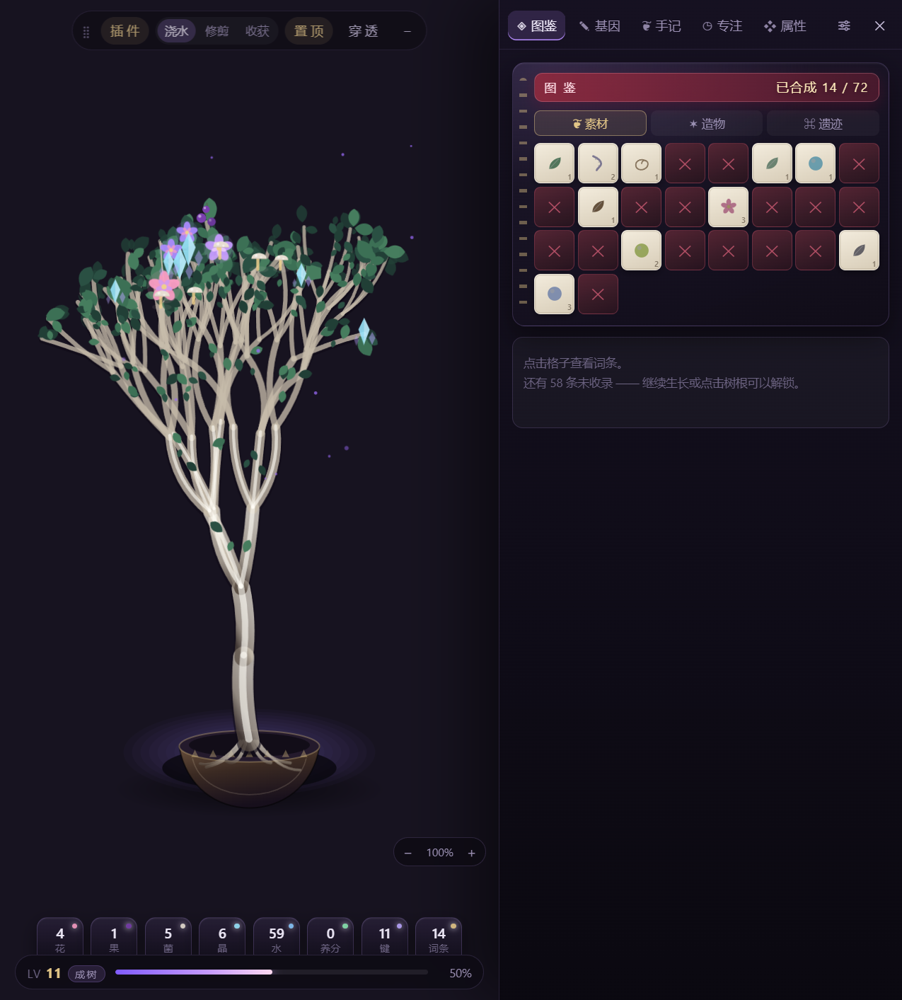

# 桌面生长树 · Desktop Grow Tree

[](https://github.com/ousheeper/growtree/releases/latest)
[](LICENSE)
[](https://github.com/ousheeper/growtree/releases/latest)

一个挂在桌面右侧的「会生长的树」小组件：树由程序实时生成，随等级长大，
枝头会结出**花 / 果 / 菌 / 晶**四类物件（各自独立计数）；
右侧是**可自由增删、排序、替换的插件栏**（图鉴 / 基因 / 手记 / 专注 / 属性 / 插件管理）。



---

## 快速开始

**方式一：下载现成 exe（最省事，推荐）**

👉 **[下载 GrowTree-1.0.4-portable.exe](https://github.com/ousheeper/growtree/releases/latest)** — 77 MB，单文件便携版

双击即用：免安装、不写注册表，首次启动自解压到临时目录（约 2 秒）。存档在
`%APPDATA%\desktop-growtree\state.json`，启动日志是同目录的 `boot.log`。
没有代码签名证书，首次运行 Windows SmartScreen 会提示"未知发布者" → 点「更多信息 → 仍要运行」。

> 便携版每次启动都解压到临时目录，所以**在 exe 里改 `plugins/` 不会保留**。要改插件请用源码版。

**方式二：源码运行（推荐给要改代码的）**

```bat
git clone https://github.com/ousheeper/growtree.git
cd growtree
npm install
双击 start.bat
```

- 首次运行会自动 `npm install`（走 npmmirror 镜像），之后直接启动
- 命令行方式：`npm start`
- 自己打 exe：`npm run dist`（便携版）、`npm run dist:dir`（绿色目录版），产物都在 `dist/`，不入库
- 需要 Node.js 18+ 与 Windows 10/11

## 桌面上的操作

| 操作 | 效果 |
| --- | --- |
| 点击树根 / 底部基座 | 浇一次水（+4~6 生长值）——受土壤湿度限制，浇满就不再吸收 |
| 敲键盘 | 自动统计全局敲击，按比例换生长值与养分（见下） |
| 鼠标移到窗口边缘 / 四角 | 边缘亮起紫线，按住可以直接拖着改大小（上下拖改高度，左右拖整体缩放） |
| `Ctrl` + 滚轮（在小部件上） | 整体缩放 60% ~ 150%（上限看屏幕放不放得下），锚点是树根 |
| 拖动太阳 | 移动独立太阳窗口，只影响之后新长的枝；放在树冠正上方时树是直的 |
| 拖动顶栏左侧 ⣿ | 移动整个组件到屏幕任意位置 |
| 点「置顶」 | 在「置顶」和「不挡」之间切换（不挡 = 其他软件会盖住它） |
| 右下角 − / + | 整体缩放 60%~150%，树根不动，只有窗口变大变小 |
| 切到「点击」点树 | 一只手伸过来点两下，+1 生长值（1.2 秒冷却，不产养分） |
| 切到「修剪」点枝条 | 剪刀动画剪掉这根枝连同下面所有分叉，+2 养分（主干剪不了） |
| 切到「收获」点花果 | 篮子接走这一颗，+1 养分 +3 生长值；左下角「收全部」一次收完 |
| 鼠标移到顶部胶囊 | 浮出按钮：插件面板、置顶、覆盖模式、鼠标穿透、隐藏 |
| 拖动顶部胶囊 / 面板标题栏 | 移动窗口（位置自动记住） |
| `Ctrl + Alt + T` | 显示 / 隐藏到托盘 |
| `Ctrl + Alt + P` | 展开 / 收起插件面板（只横向变宽，树不会上下跳） |
| `Ctrl + Alt + L` | 鼠标穿透开关（穿透后只能靠热键恢复） |
| `Ctrl + Alt + G` | 直接浇水（游戏里也能用） |
| 托盘图标左键 | 显示 / 隐藏 |

**三种显示模式**（顶部胶囊里切换）：

1. **普通置顶** —— 盖在普通窗口上面，alt-tab 切走也不掉。
2. **覆盖模式（◉）** —— 提升到 `screen-saver` 层级，可盖在全屏游戏 / 视频上（就是参考图的效果）。
3. **鼠标穿透（⌖）** —— 窗口完全不挡鼠标，树只管看；再按一次热键恢复。

透明区域默认可点击穿透：只有真正的 UI（顶栏、树、基座、面板）会拦住鼠标，其余区域鼠标直接落到桌面上。

## 浇水有上限：土壤湿度

浇水不再是无限点：

- 底座新增「**水**」格子，显示当前土壤湿度 0~100%
- 每浇一次 **+18%**，湿度 >82% 时再点会被拒绝，提示「土还湿着」
- 湿度按 **0.3%/秒** 自然风干（100% → 0 约 5 分半），离线期间也照风干
- 所以实际上限是：**同一时间段内最多连浇 5 次，之后约 45~60 秒才能再浇一次**

配合 0.65 秒的点击冷却，浇水从"无限刷"变成了"隔一会儿浇一壶"。

## 键盘也能养树

主进程挂了系统级键盘钩子（`uiohook-napi`），**在任何程序里敲的键都算**：

| 累计敲击 | 回报 |
| --- | --- |
| 每 40 次 | +1 生长值 |
| 每 200 次 | +1 养分 |

- 底座新增「**键**」格子显示今日敲击数，属性页有今日 / 累计 / 换得的养分
- 长按只算一次（按"按下-抬起"配对过滤自动重复）
- 每 2 秒批量上报一次，不逐键打扰渲染进程
- 只在主进程运行，**不记录按了什么键**，只记次数

## 枝头挂果（四种，分别计数）

| 种类 | 形态 | 登场等级 | 上限 |
| --- | --- | --- | --- |
| 花 | 5 瓣花 / 垂铃 / 眼（稀有） | 1 级 | 13 |
| 果 | 2~3 颗成串浆果 | 2 级 | 9 |
| 菌 | 小伞菌 | 3 级 | 7 |
| 晶 | 晶簇（带切面高光） | 4 级 | 6 |

为了保证「多样但不杂乱」，做了三件事：

1. **统一画法**：四类物件共用同一套扁平填色 + 小高光，尺寸都在 12~22px 区间；
2. **同色系**：颜色全部从当前调色板取，一棵树只用 4 类颜色；
3. **就近聚类**：新挂果有 62% 概率跟随 26px 内最近的同类，形成一小簇而不是撒胡椒面。

其中一部分果子不是长在枝头，而是**从枝条上垂下来**：一根细梗从枝头垂下 22~42px，末端挂着果子或铃花。
为了不被叶子挡住，垂枝只挑树冠下半缘的枝头，并避开画布边缘；每棵树至少保证一颗。

底部 8 个格子分别显示 **花 / 果 / 菌 / 晶 / 水 / 养分 / 键 / 词条**，右上角小圆点是该类的主题色。

## 四种工具，光标就是工具

顶栏中间四段开关，鼠标移到树区时光标直接变成对应工具：

| 模式 | 光标 | 点下去发生什么 |
| --- | --- | --- |
| 浇水 | 水壶 | 水壶在你点的位置浮出、倾斜、六滴水落到那一点 |
| 修剪 | 剪刀 | 剪刀落在被点的枝条上剪两下 |
| 收获 | 竹篮 | 小篮子升到那颗花果下面接住 |
| 点击 | 手 | 一只手从右下伸过来，指尖点在树上点两下，+1 生长值 |

光标是内联 SVG 的 `cursor: url(data:image/svg+xml,...)`，不用外部图片；
每个光标的**热点**都对准工具的动作点（水壶在壶嘴、剪刀在刃尖、手在指尖），
所以点哪儿，动画就出现在哪儿。

「点击」模式没有收益门槛但也没有养分：每次 +1 生长值、1.2 秒冷却，
比「每 4 秒 +1」的时间增长略快一点，适合挂着的时候顺手摸两下。

## 操作都带动作

浇水、修剪、收获、升级各自有一段短动画，不挡操作、不占资源（`src/js/fx.js` + 纯 CSS 关键帧）：

| 动作 | 动画 |
| --- | --- |
| 浇水 | 水壶从右侧浮出 → 倾斜 34° → 六滴水从壶嘴落进石盆 → 收走 |
| 修剪 | 剪刀落在剪口，两片刀口开合剪两下，闪光 + 四片木屑飞出 |
| 收获 | 小竹篮从下方升起接住果子，金色光点上浮 |
| 升级 | 盆口扩散两圈光环 + 五点上浮 + `LV n` 浮字 |

坐标全部跟着你点的地方走：水壶出现在点击点右上方、壶嘴正对点击点，水滴落点就是那个坐标；
剪刀锚在被点的枝条上，篮子锚在被收的花果上，手的指尖落在点击点。

## 修剪 / 收获

顶部中间三段开关切换模式，互不干扰：

**修剪**（红色高亮）
- 鼠标移到枝条上会整根亮起，点一下就剪掉——连带它下面的所有分叉
- 每剪一刀 +2 养分、+3 生长值（把枝条还给土）
- 剪过的位置记在 `state.pruned` 里，**升级、重启、换配色都不会长回来**
- **主干剪不动**（点了会提示），否则整棵树会消失
- **剪不死**：单刀最多带走全树 50% 的枝，剪完至少留 4 根；越界直接拒绝并提示
- **大枝要确认**：一刀超过全树 12% 时弹应用内确认框，写清「带走几根、还剩几根」，Esc 或点遮罩取消
- 想反悔：「属性」页 → 恢复所有修剪

**收获**（金色高亮）
- 点亮头的花果，收走一颗 +1 养分 +3 生长值，右下角计数同步减少
- 左下角「收全部 N」一键收完，会按种类汇总提示（花 x · 果 y · 菌 z · 晶 w）
- 收完的枝头这轮是空的，**7 分钟后同一根枝头会重新结一颗**（升级也会清空重来）
- 老存档里没有采摘时间的记录，升级后当作「早该长了」，树不会一直是光的

底下的实现有个前提：**树的每个枝节点都有自己的随机数**（用"路径 + 种子"哈希出来的）。
所以剪掉一枝、收走一颗果，其余部分不会跟着乱跳；换等级时老枝条也保持原样，只是从末端继续长——
这才是"长大"，而不是每次换一棵新树。

## 太阳：独立窗口，拖到屏幕任何地方

太阳不再是组件里的一颗装饰，而是**一个独立的小窗口**（108×108，透明、置顶、可拖到屏幕任意角落，包括别的软件窗口上面）。
窗口比球体大一圈：光晕是画在窗口内部的径向渐变，到边缘刚好淡成 0，所以不会出现"被窗口切出来的方框"。
（老存档第一次带窗口位置启动时，会量一次树冠高度把太阳摆到它正上方，之后不再动。）

**关键规则：太阳只影响"之后长出来的枝"。**

- 每根枝条在"出生"那一刻，会记下当时的太阳方向（存进 `state.branchTilt`）
- 所以拖太阳时：**树的形状一点不动**，只有枝叶的明暗、地面辉光跟着光走
- 下次升级、新枝冒出来时，它们才会朝现在的太阳方向弯
- 种子换了（相当于重新种一棵），记录清空，从头开始按新太阳长

强度可在「基因 → 枝叶与挂果 → 向光强度」调（0 = 完全忽略太阳）。

倾角的算法：取太阳窗口中心相对**树区**的水平/竖直偏移，算出相对"正上方"的角度，
乘 0.35 的增益后再夹到 ±17°。只依赖窗口矩形，不经过 SVG 坐标换算，
所以缩放、开关面板、改窗口大小都不会让方向翻掉。太阳在树根下方时几乎不产生弯曲。

> 早前版本这里用 SVG 坐标反推，只要窗口尺寸或缩放一变就可能算出反方向，
> 表现为"剪完枝树往左倒"。现在 `state.tiltVer` 会标记算法版本，升到 2 后旧数据自动作废重算。

## 生长阶段：从种子开始

形态不是一开始就是树，按等级分四段（底座左侧的 `LV n` 后面会显示当前阶段）：

| 阶段 | 等级 | 长什么样 | 枝干数 |
| --- | --- | --- | --- |
| **种子** | 1 | 破土的小芽，顶端两片子叶；盆缩到 52%，不画根、不开花 | 2 |
| **幼苗** | 2–3 | 一根细茎，顶端分两叉；盆 68%，根很浅 | 4 |
| **小树** | 4–6 | 开始有层次，3 层分叉；盆 86%，根正常 | 13 |
| **成树** | 7+ | 4→6 层逐步加深，10 级后枝头还会再冒新枝 | 33 → 418 |

早期阶段没有"分层"可以加，所以用**每级长高**（幼苗 +16、小树 +18）来体现生长；
种子和幼苗**不挂果**——刚破土就开花不符合常理，从「小树」才开始结果。

## 它到底怎么生长

| 来源 | 生长值 |
| --- | --- |
| 时间 | 每 4 秒 +1（关掉后重开，按离线时长补 0.12/秒，上限 1 小时） |
| 敲键盘 | 每 40 次 +1 生长值；每 200 次 +1 养分 |
| 点树根/基座浇水 | +4~6（0.65 秒冷却，18% 概率 +2） |
| 修剪一刀 | +3（小枝 +2 养分，剪掉超过 25% 只给 +1） |
| 收获一颗 | +3（另 +1 养分） |

升级门槛 `32 + 等级×16 + 等级^1.4×3`，每升一级：

1. **长高**：主干每级 +0.8~1.1，整体高度约 +2%
2. **多结果**：挂果上限每级 +1.45（再乘「挂果密度」）
3. **换阶段**：1 / 2 / 4 / 7 级各换一次形态（见上表）
4. **第 7 级起**：分叉层数从 4 层开始，每 3 级加深一层，最高 6 层（枝干 33 → 106 → 418）
5. **第 10 级起**：约 `(等级-9)/45` 比例的枝头会再多冒一层新枝（最多 40%）
6. **解锁一条图鉴词条**，并重新结果（上一轮收掉的果子长回来）

修剪掉的枝不会因为升级而复活（记录在 `state.pruned`），想让它们回来就用「属性 → 恢复所有修剪」。

图鉴共 **72 条**（素材 26 / 造物 26 / 遗迹 20），稀有度越高越难出，每升一级解锁一条。

## 基因（树的形态完全可改）

面板「基因」页分 5 组，全部实时生效：

- **形态**：主干高度、分叉张角、枝条扭曲、分叉数量
- **枝叶与挂果**：叶片密度、挂果密度、向光强度、四类挂果的开关（关掉就不长）
- **显示**：整体缩放 70%~150%（等价于 Ctrl+滚轮）
- **花色**：克苏鲁 / 绯樱 / 余烬 / 虚空 四套调色板（同时决定果实与晶体的颜色）
- **种子**：#数字，换一个就是另一棵树；「恢复默认」一键回到初始基因

所有参数存在本地，下次打开还是它。

## 插件系统

右侧栏的每一页都是一个插件，**文件夹即插件**：

```
plugins/
  codex/plugin.js      图鉴
  genes/plugin.js      基因编辑器
  journal/plugin.js    手记
  pomodoro/plugin.js   专注钟
  stats/plugin.js      属性 + 重置
  <你的插件>/plugin.js
```

插件只要做一件事：调用 `GrowTree.register({ id, name, icon, mount(el, ctx) })`。
完整模板见 [`docs/plugin-template.js`](docs/plugin-template.js)，复制到 `plugins/你的id/plugin.js` 即可。

```js
GrowTree.register({
  id: 'my-plugin',
  name: '示范',
  icon: '✦',
  mount(el, ctx) {
    el.innerHTML = `<button class="btn primary">浇水 +10</button>`;
    el.querySelector('button').onclick = () => {
      ctx.addXp(10, 'manual');   // 加生长值
      ctx.burst(12);             // 树根粒子
      ctx.toast('浇水 +10');      // 底部提示
      ctx.log('有人递来一杯水。', 'feed');  // 写进手记
    };
    const off = ctx.on('levelup', ({ level }) => console.log('升级', level));
    return { destroy() { off(); } };
  }
});
```

### ctx 可用能力

| 成员 | 说明 |
| --- | --- |
| `ctx.state` | 全局状态（等级、生长值、词条、手记、基因…） |
| `ctx.patch(fn)` | 改状态并落盘，`fn(state)` |
| `ctx.addXp(n, reason)` | 加生长值，可能触发升级 |
| `ctx.log(text, kind)` | 写手记，kind = `grow`/`feed`/`codex`/`note` |
| `ctx.refreshTree(animate)` | 重绘树 |
| `ctx.burst(n)` / `ctx.toast(msg)` | 粒子 / 提示 |
| `ctx.on(evt, fn)` | 订阅 `xp`/`levelup`/`codex`/`journal`/`genes`/`tree-stats`，返回取消函数 |
| `ctx.switchTo(id)` | 跳到另一个插件页 |

### 管理插件

面板右上角 **⚙**：

- 开关某个插件（关掉的不会加载 Tab）
- `↑ ↓` 调整顺序
- 「打开插件目录」「重新加载」（改完代码不用重启）
- 新插件放进去 → 重新加载 → 自动出现在栏里

## 数据与重置

- 状态文件：`%APPDATA%\desktop-growtree\state.json`
- 重置：面板「属性」页 → 重置全部数据（词条、手记、等级一起清空）

## 目录结构

```
desktop-growtree/
  main.js              主进程：透明窗口、托盘、热键、持久化、插件目录扫描
  preload.js           contextBridge 暴露的白名单 API
  src/
    index.html         壳层
    styles/            base.css（壳层） plugins.css（内置插件样式）
    js/
      bus.js           事件总线
      tree.js          程序化树生成器（纯 SVG，无图片资源）
      codex-data.js    48 条词条数据
      store.js         状态 / 生长 / 存档
      host.js          插件宿主 + 插件管理面板
      app.js           主控
  plugins/             内置插件（可整目录删掉，不影响启动）
  docs/plugin-template.js
  start.bat
```

## 已知限制

- Windows 独占（用了 `setIgnoreMouseEvents` + 透明窗口，macOS/Linux 未验证）。
- 全屏**独占**（exclusive fullscreen）游戏仍然盖不住，请把游戏改成「无边框窗口」再用覆盖模式。
- 树是程序生成的矢量图，同一颗种子结果固定；图形细节不如手绘素材精致。
  （已做的拟真处理：叶片分前后两层、受光侧树干高光、细枝降饱和、叶簇大小随机、四类挂果成簇分布）
- 缩放走 CSS `zoom`，非整数倍（如 105%）时边缘可能有轻微模糊。
- 窗口大小 = 设计尺寸 × 缩放，所以整体缩放时宽高一起变（不能单独拉成很扁/很瘦的形状）；想改高矮就拖上下边，那只是改留白，不改变树的形状。
- 放大到「窗口顶住屏幕上边」之后，再放大会整块往下让位（不然顶栏会被切掉）。
- 便携版 exe 每次启动解压到临时目录，所以**在 exe 里改插件不会保留**；要改插件请用源码版（`start.bat`）或把 `dist/win-unpacked` 整个目录留着用。
- 代码签名：没有证书，Windows SmartScreen 首次运行会提示"未知发布者"，点「更多信息 → 仍要运行」即可。

## 许可证

[MIT](LICENSE) © 2026 ousheeper

树是程序生成的，没有用任何第三方美术素材；Electron 与 electron-builder 遵循各自的开源许可。
